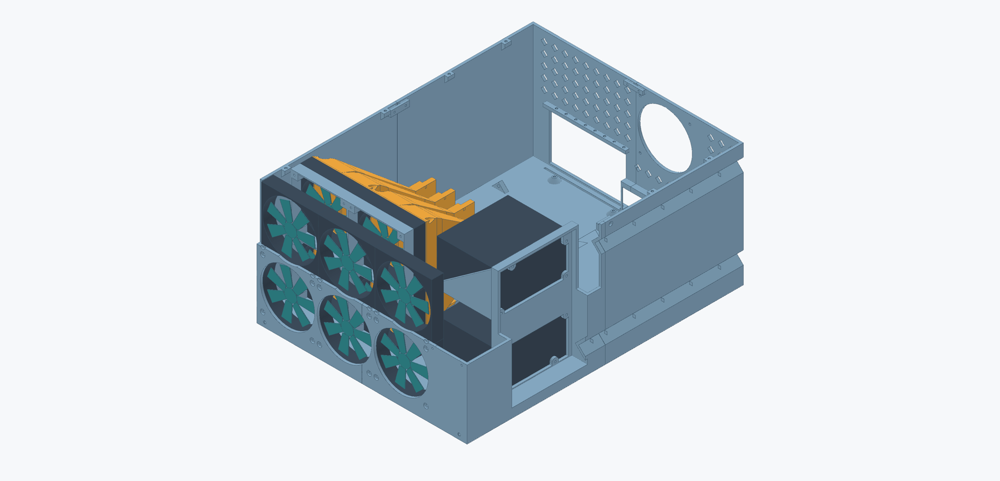
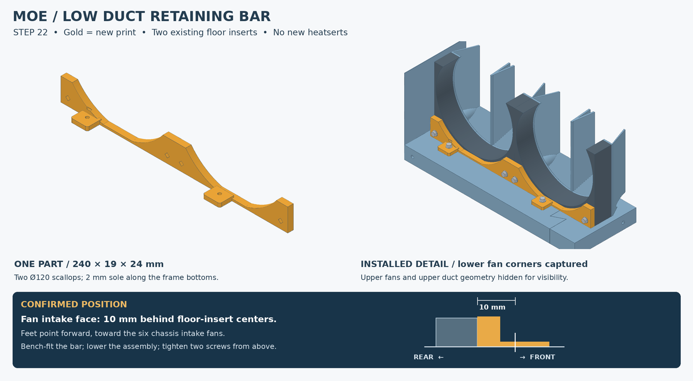

<div align="center">

# MOE
### A printed 6U home for four Radeon Pro V620s

**Four chassis sections · Dual 1000 W PSUs · Ducted GPU cooling · A removable lid**

[Assembly guide](docs/assembly.md) · [Build the STLs](docs/development.md) · [STEP models](cad) · [Known issues](https://github.com/PraxisOG/moe-chassis/issues)



*CAD architecture view from Step 20. The latest low retaining bar is shown below; fans and PSUs are simplified references.*

</div>

MOE is a custom, shelf-supported server chassis built around an **ASUS WS X299 SAGE**, **four AMD Radeon Pro V620 GPUs**, and **two Super Flower 1000 W supplies**. Four interlocking printed sections make a large enclosure printable on a Prusa XL. Steel rods, recessed bridges, and upper wall straps join the shell; paired ducts direct a separate 2 × 2 fan bank toward the GPUs.

This repository preserves the printed build and its fit history. It includes Python build tools, editable STEP solids, available CadQuery sources, actual CAD renders, and assembly instructions. Generate the 34 oriented STL files locally with `python tools/export_prints.py`; prebuilt STLs and print ZIPs are not tracked.

> [!IMPORTANT]
> **Two physical fit defects remain open in the published chassis.** [#1: more rearward clearance for the GPU bracket top flanges](https://github.com/PraxisOG/moe-chassis/issues/1) and [#2: thinner PSU screw seats, approximately 2 mm](https://github.com/PraxisOG/moe-chassis/issues/2). These are recorded bugs, not implemented fixes. Review them before printing another chassis.

## Start here

| Goal | Open this |
|---|---|
| Assemble the whole machine | [Assembly sequence](docs/assembly.md) |
| Print the parts | [Print selection and orientation](docs/printing.md) · [Local STL build](docs/development.md) |
| Replace the awkward fan carrier | [Step 22 retaining bar](docs/duct-assembly.md) |
| Order or sort fasteners | [Hardware list](docs/hardware.md) |
| Fit the lid | [Lid assembly](docs/lid.md) |
| Change the design in Fusion | [STEP models](cad) · [Dimensions and datums](docs/dimensions.md) |
| Rebuild generated CAD | [Source and rebuild instructions](docs/development.md) |

## Generate the print files

After installing the pinned Python dependencies, run:

```bash
python tools/export_prints.py
python tools/validate_package.py --prints build/print
python tools/package_prints.py
```

[Full setup and build instructions](docs/development.md). The chassis exports from its preserved STEP assembly; the original early chassis generator is unavailable. Duct, lid, and bar generator scripts are included.

## Built around airflow and access

- **Six front intake fans:** a tight 3 × 2 array leaves the front-right PSU region clear.
- **Four GPU passages:** two paired ducts each split the airflow from two vertically stacked 120 mm fans.
- **Duct support from the chassis:** no GPU attachment screws or TPU couplers in the current duct bodies.
- **Dual PSU mounting:** recessed right-side exhaust faces, opposing intake fans, and an open upper shelf.
- **Service provisions:** rear CPU exhaust, diamond rear vents, cable-tie points, and rearward power-cord channels.
- **A low cover:** four overlapping lid panels fasten to the eight existing rim inserts.

These are design features. Airflow, acoustics, structural capacity, and long-term PETG creep have not been certified or quantified here.

## Current mounting change — Step 22



The printed duct mount was awkward to install. The replacement is **one 240 × 19 × 24 mm bar** that uses the two front floor heatserts and captures the lower corners of the two bottom duct fans. Its feet point toward the front intake bank; the duct-fan intake faces sit **10 mm behind the heatsert centers**. Two 120 mm scallops keep the bar low around the inlets.

Bench-assemble the bar, fans, and ducts, lower them into the chassis, then reach the two floor screws from above. Keep the support needed beneath the rear duct bodies. **The bar is modeled and checked, but its physical fit is not yet reported.**

[Build the bar STL](docs/development.md) · [Bar STEP](cad/ducts/MOE_Duct_Retaining_Bar_Step22.step) · [Assembly and changed bolt lengths](docs/duct-assembly.md)

## Dimensions at a glance

| Item | Nominal value |
|---|---|
| Chassis width × depth × height | 444.50 × 584.20 × 260.35 mm / 17.5 × 23 × 10.25 in |
| Height with Step 21 lid and specified hardware | **265.35 mm / 10.447 in** |
| Margin below the nominal 6U envelope | **1.35 mm** below 266.70 mm / 10.50 in |
| Base / ordinary walls | 19.05 mm / 5.00 mm |
| Front fans / rear CPU exhaust | 6 × 120 mm / 1 × 120 mm |
| GPU fan bank | 4 × 120 mm, 2 wide × 2 tall; ARCTIC P12 Pro A-RGB build intent |
| Power supplies | 2 × 1000 W; 38.1 mm exhaust-face recess |
| Main prints / chassis connectors | 4 quadrants / 4 underside bridges + 3 upper straps |
| As-built rods | 4 × Ø4 mm rods in Ø4.3 mm channels; middle crosswise channel empty |
| Inserts | M3 ruthex RX-M3Sx4.0; install flush |

The height starts at the chassis underside and excludes a separate shelf, feet, or padding. There are no rack ears in this model; support the base on a rack shelf. Measure the finished print because the lid height margin is small.

## The cover


Four flat-printing panels, 4 mm skin, 1 mm upper ribs, and inclined overlap seams. **Eight M3×6 screws with 0.5 mm washers** attach to the existing rim inserts. [Install RR → RL → FR → FL](docs/lid.md).

## What is in the repository?

| Folder | Contents |
|---|---|
| [`tools/`](tools) | Export all 34 print files, validate them, package a ZIP, or run the available generators |
| [`cad/`](cad) | Chassis assembly, duct/support parts, lid assembly, bar, and interface references |
| [`docs/`](docs) | Current illustrated instructions, hardware, dimensions, and revision notes |
| [`renders/`](renders) | Actual CAD views; new features highlighted in gold |
| [`source/`](source) | Available CadQuery scripts for Steps 20–22 |
| [`checks/`](checks) | Saved geometry/mesh checks and the file integrity manifest |
| `build/` (generated locally) | Oriented STLs and optional ZIP; excluded from Git |

The [older illustrated PDFs](docs/archive/README.md) remain available for construction detail. Their old carrier instructions and pre-bug PSU instructions are superseded by the current Markdown guides.

## Build status

The main chassis is the **Step 16 / Step 15-compatible printed baseline**. The ducts are Step 20, the lid Step 21, and the retaining bar Step 22. The builder uses **four rods**, omitting the middle crosswise rod to accommodate longer stock. The original CAD still has five channels.

[Revision history](docs/revisions.md) records what changed. No chassis, duct, or lid geometry was altered during this repository publication. The two reported fit defects are intentionally left visible and linked to their issues.
