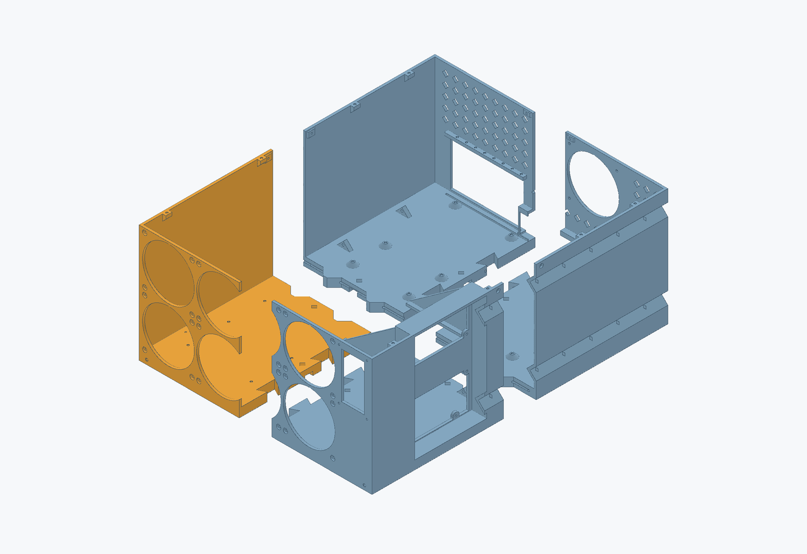
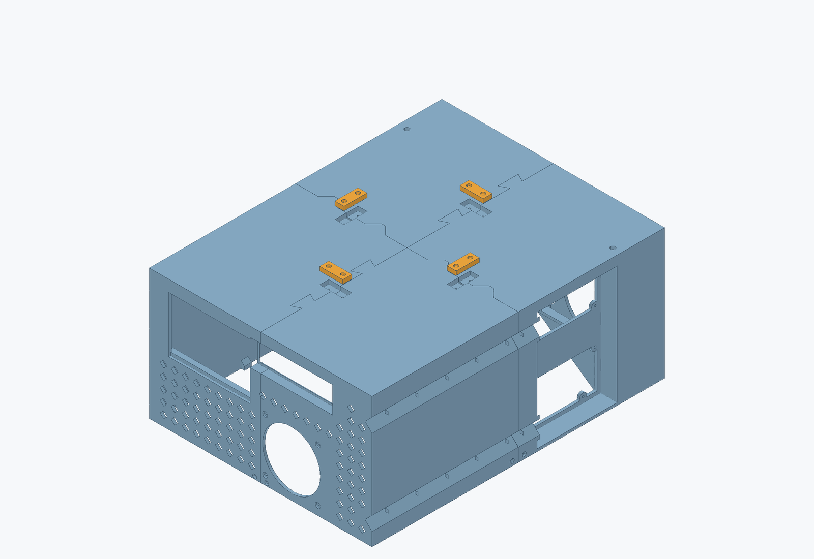
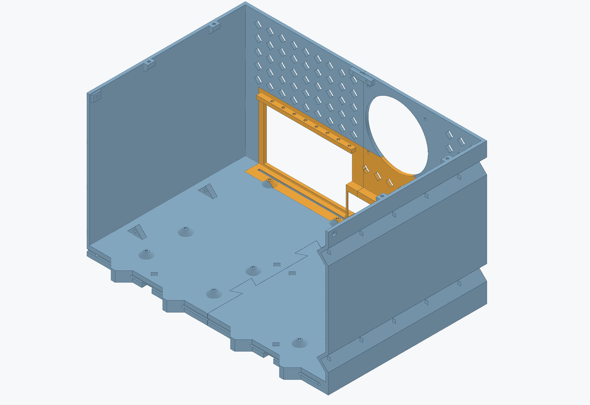
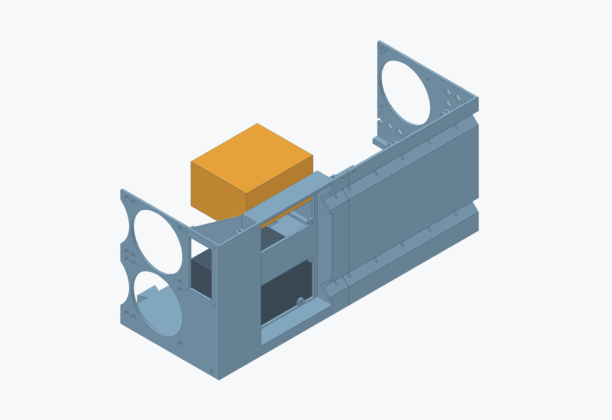

# Assemble MOE

[← Project](../README.md) · [Hardware](hardware.md) · [Print selection](printing.md)

Left and right mean **standing at the front, looking toward the rear**. Work on a flat surface and finish the underside hardware before electronics obstruct it.

## 1. Join and reinforce the shell

1. Identify rear-right, rear-left, front-right, and front-left. The Step 16 front-left has six floor insert pockets; the other quadrants and connectors remain compatible with the Step 15 prints.
2. Install the needed M3 heatserts flush: nine motherboard, eight card-retention, eight lid, and six floor pockets. The modeled insert is **RX-M3Sx4.0**, in a Ø4 × 5.2 mm blind pocket.
3. Set rear-right on the bench. Lower rear-left into it, add front-right, then lower front-left into both neighboring joints. The dovetails and tongues engage vertically; the exploded view is for identification.
4. Confirm the base sits in one plane. The nominal straight seam gap is 0.30 mm; do not pull it closed with the screws.

5. Turn the supported empty shell over. Fit all four recessed base bridges using **8 × M3×14**, eight nuts, and sixteen washers. Screws enter from below; the interior nut and washer sit in the recessed pockets.
6. Fit the left, right, and rear upper straps using **6 × M3×12**, six nuts, and twelve washers.
7. Insert the **front and rear crosswise rods first**, from the left, then the two longitudinal rods from the front. **Leave the middle crosswise channel empty for this build.** The stock is Ø4 mm; channels are Ø4.3 mm.
8. Check the actual longer rod ends and the two M3×18 stop positions. A rod must not obstruct a stop bolt. Complete rod containment before handling a loaded chassis.

Keep base nuts, washers, and bolt tips recessed below the interior floor, especially beneath the motherboard. Support the whole base in the rack; the printed walls are not lifting handles.

## 2. Fit the chassis fans

Install the six front 120 mm fans on the **inside**, blowing into the chassis. They form a packed 3 × 2 array starting at the left inside wall. The middle column spans the front quadrant seam.

Fit the rear 120 mm CPU fan above the motherboard I/O opening, blowing out. The front and rear chassis fan screws enter from outside through recessed seats with **2 mm remaining wall thickness**. These use appropriate fan-frame screws, not the M3 through-bolt scheme used on the ducts.

The 240 mm fan stack has only 1.30 mm nominal clearance below the rim. Check actual frame corners and wiring.

## 3. Install I/O, motherboard, and GPUs

1. Fit the I/O shield in its 1.2 mm edge before lowering the motherboard.
2. Seat the X299 SAGE on all nine integrated standoffs. M3×5 is the documented starting screw length; confirm engagement with the actual PCB and washer stack.
3. Guide the GPU lower bracket tabs into the continuous rear channel while seating each card fully and level in its PCIe slot.
4. Align retention screws only after the card is naturally seated.

> **Open fit bug:** [rear bracket top flanges need more rearward clearance (#1)](https://github.com/PraxisOG/moe-chassis/issues/1). Do not use the retention screw to pull a card or bracket past that interference. The published rear chassis has not been corrected.

## 4. Position the two PSUs

- Lower PSU sits on the floor, **intake facing up**.
- Upper PSU rests on both shelf rails, **intake facing down**.
- Both exhaust faces point toward the recessed right side. Their intake fans face each other across the central gap.
- Route the C13 cables rearward in the open side channels and retain them through the diamond tie passages.

> **Open fit bug:** [the PSU screw seats are too thick (#2)](https://github.com/PraxisOG/moe-chassis/issues/2). The current approximately 5 mm panel prevents the standard screws from retaining the PSUs adequately. The requested future fix is approximately **2 mm at each of the eight screw lands**. Do not treat the present mount as secured just because a screw has started. Use PSU-approved **#6-32** hardware; this guide does not prescribe an unverified longer substitute.

## 5. Install the duct assembly

Use the [current Step 22 duct instructions](duct-assembly.md). Bench assembly avoids working the fan-corner nuts in the narrow chassis gap. The low bar replaces the tall carrier at the frontmost floor inserts; retain the support needed under the duct bodies.

## 6. Route wiring and close the lid

Use perimeter tie points and keep service loops away from rotors, GPU connectors, and PSU intakes. Fit the [Step 21 lid](lid.md) once the fans, cooler, and wiring clear its flat underside.

Before power, confirm that the base and rod ends are secure, the cards are seated without forced bracket preload, both supplies are retained appropriately, and every rotor turns freely. Check cooling under increasing load after mechanical fit is resolved; CAD clearance is not a thermal test.

For more construction illustrations, see the [archived chassis PDF](archive/MOE_Chassis_Assembly_Guide.pdf), with the current bug notes above taking precedence.
