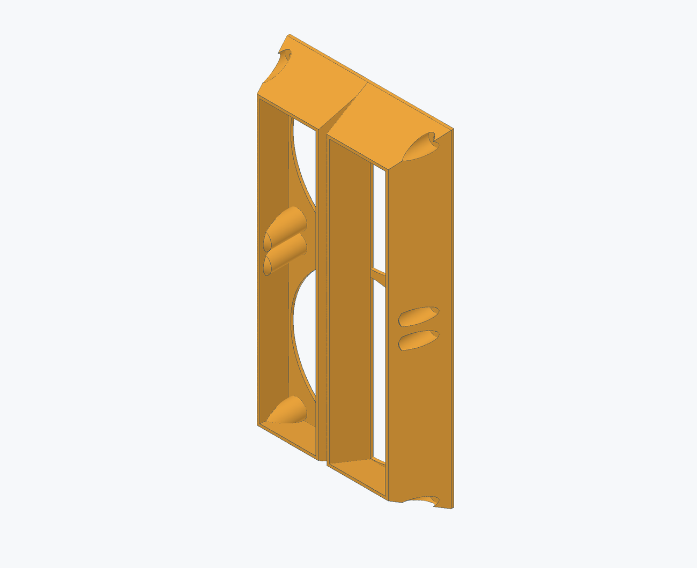
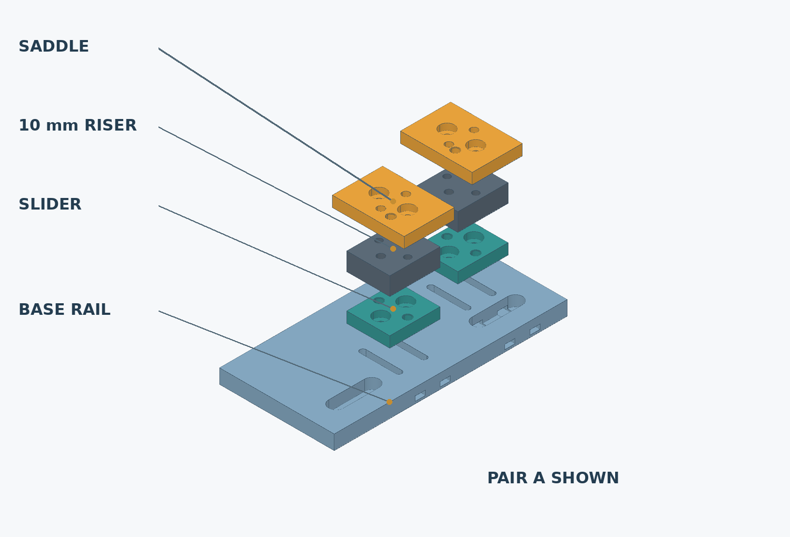

# Duct assembly — current Step 22 bar

[← Assembly](assembly.md) · [Hardware](hardware.md) · [Build bar STL](development.md)

The current option replaces the **240 × 240 × 20 mm tall fan carrier** with one low bar. The bar anchors the fan end to the two front floor heatserts. It does not replace the support needed to carry the rear duct bodies, and it does not attach to the GPUs.

## Orientation and position

Pair B is the left duct column and Pair A the right, viewed from the chassis front. Each column has two vertically stacked fans. All four fans blow rearward into the ducts toward the GPUs.

The bar sits against the **front/intake faces of the lower two fans**. Its feet point forward, toward the six chassis intake fans. The fan intake faces sit **10 mm behind the front heatsert centers**, matching the builder's clarified position.

| Datum | mm |
|---|---|
| Two front floor anchors | X260 / X400, both Y520 |
| Fan intake / rear bar face | Y510 |
| Bar envelope | 240 wide × 19 fore-aft × 24 high |
| Bar thickness / foot thickness | 6 / 4 |
| Airway relief | Two Ø120 open-top scallops; 2 mm bottom connecting strip |
| Lower fan hole centers | X199.5, 304.5, 319.5, 424.5; Z26.55 |

The existing CAD predicts 44.2 mm between the duct-fan intake faces and the back of the front chassis fans. The approximately 1.5-inch physical gap is a secondary estimate; **the 10 mm heatsert offset controls this part**.

## Hardware for one nominal 25 mm fan stage

| Connection | Hardware |
|---|---|
| Bar feet → floor heatserts | 2 × M3×8 + 2 washers |
| Four lower fan corners captured by the bar | 4 × M3×45 + 8 washers + 4 nuts |
| Remaining twelve fan corners, without the old carrier | 12 × M3×40 + 24 washers + 12 nuts |

Washers: 0.5 mm thick, OD ≤7 mm. Nuts: M3, 5.5 mm across flats, approximately 2.4 mm high. These lengths account for the unchanged 6 mm duct screw seats. Check actual fan thickness and thread protrusion.

**Removing the old 20 mm carrier changes the bolt lengths. Do not blindly reuse the old M3×55 bolts.** An extra fan stage needs a separate stack/clearance check; the old carrier's M3×80 instructions do not apply automatically to the new bar.

## Do the small-fastener work on the bench

1. Remove the tall carrier. Keep any cradles or other rear support that currently carries the ducts.
2. Arrange the two duct/fan modules on the bench with the airflow arrows pointing into the ducts. Route cables toward accessible edges.
3. Place the rear face of the bar against both lower fan intake frames. The feet face forward and down. Align the two lower holes of each lower fan with the bar.
4. Insert the four M3×45 bolts from the front, through **bar → fan → duct seat**. Put a washer under each head and a washer/nut in the existing rounded duct recess. A slim 5.5 mm nut driver holds the rear nut.
5. Install the remaining fan-corner bolts appropriate to the shorter stack. Start all hardware before snugging the frames evenly. Do not bow the frames.
6. Lower the joined assembly into the chassis, supporting the fan frames and substantial duct walls. Let the GPU ends seat naturally; the ducts must not carry their weight through the PCIe cards.
7. Align the bar feet with the two front inserts. Install the **two M3×8 floor screws from above**, with washers. A 10 mm vertical driver envelope was checked in CAD.
8. Bring the rear supports into even contact, then snug the bar and fan fasteners without moving the GPUs. Turn every rotor by hand and inspect cable/rotor clearance.

For removal, disconnect fan leads, release the two bar-floor screws and any duct-to-support fasteners, and lift the supported assembly out. Reach the fan-corner nuts on the bench.

## Existing adjustable cradles

The original supports are generated in `build/print/cradles-and-shim`. They were reported awkward to use, so they are not presented as a verified cure for the current fit. Use them only where they seat naturally beneath the fitted ducts.

Layer order is **base → slider → riser → saddle → duct foot**. Install eight slider inserts and four saddle inserts, plus eight side-loading M3 track nuts. Base screws are M3×6; slider clamps M3×10; 10 mm riser stacks M3×16; duct ears M3×8. Keep A/B and front/rear saddles identified because their insert offsets differ. Raising a support must not lift the fan bank or press an outlet into a GPU.

The [older duct PDF](archive/MOE_Duct_Assembly_Guide.pdf) illustrates these supports. Its tall-carrier and long fan-bolt sections are superseded here.

## What has been checked?

The bar is one valid solid with a watertight STL and a passing 45° print-overhang screen in the supplied orientation. Its nominal hardware clears the existing chassis, fan frames, and duct reference. Actual installation, stiffness, creep, rotor clearance, and cooling still require the physical build.
