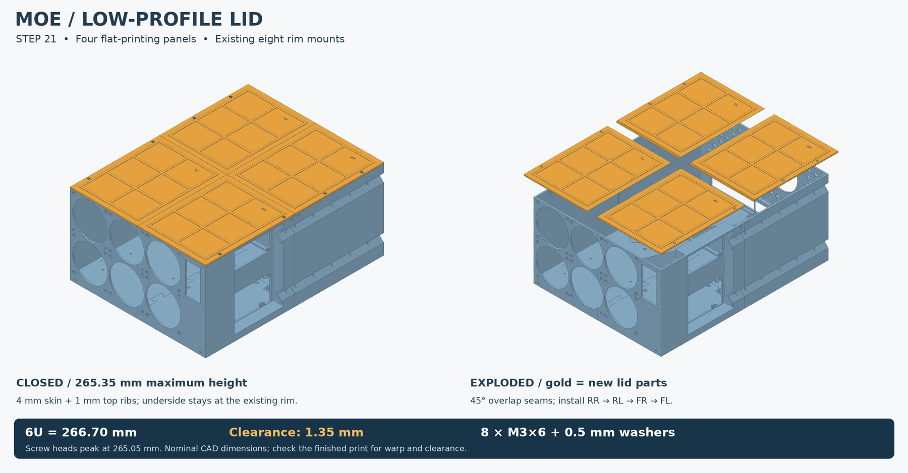

# Four-panel lid — Step 21

[← Assembly](assembly.md) · [Build STLs](development.md) · [STEP](../cad/lid/MOE_Lid_Step21.step)

The lid uses the eight existing rim inserts. A 4 mm skin and 1 mm upper ribs bring the modeled total height to **265.35 mm**, with the specified screw heads below the rib tops. That leaves **1.35 mm beneath nominal 6U (266.70 mm)**. The underside stays at the original 260.35 mm rim height.

Print all four panels flat, underside down, ribs and engraved IDs up. They fit a 350 mm bed without scaling. Keep them flat; this is a cover, not a shelf.

Use **8 × M3×6 socket-cap screws** and **8 × 0.5 mm washers, OD ≤7 mm**. Heads must fit the modeled Ø5.5 × 3 mm envelope. The counterbores are Ø8 × 2.8 mm deep. Install rim inserts flush. **M3×8 is too long for this lid's modeled blind pockets.**

1. Clear debris from the rim and panels.
2. Lower **rear-right (RR)** first and loosely start its two screws.
3. Add **rear-left (RL)**, then **front-right (FR)**, then **front-left (FL)**. The inclined overlaps settle from above.
4. Start all eight screws before snugging. Do not crush the 0.30 mm seam clearance or dimple the thin screw seats.
5. Check that the cover rests on the rim, not on fans, the cooler, or wiring. Measure actual height and flatness.

Remove in reverse order: FL → FR → RL → RR. Separate rack-shelf thickness, feet, and padding are outside the 265.35 mm calculation.

[Full dimensions and hardware calculation](reference/Lid21_Readme_And_Dimensions.txt)
