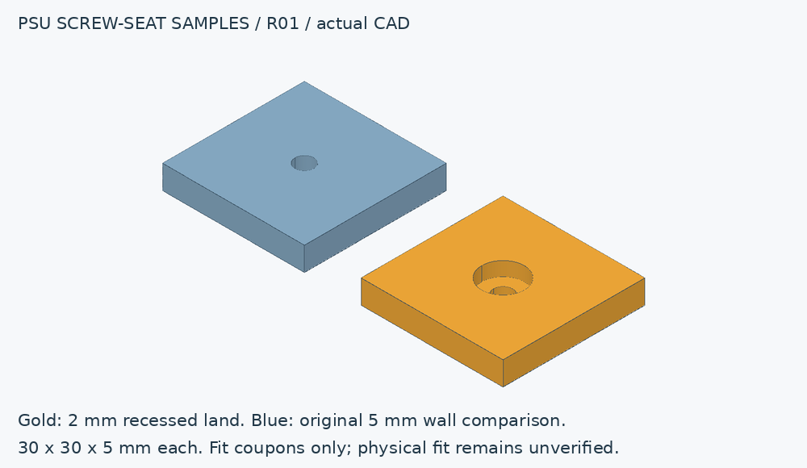

# PSU screw-seat fit samples — R01

[Variant plan](x10drg-q-plan.md) · [Project](../README.md)

These two small samples isolate upstream [issue 2](https://github.com/PraxisOG/moe-chassis/issues/2):
standard PSU screws did not engage adequately through the original 5mm wall.
They are not mounting plates or structural supports, and do not resolve the
issue until actual hardware is checked.



| Sample | Overall dimensions | Screw-bearing thickness | Hole / head recess |
|---|---|---|---|
| Gold, proposed local recess | 30 × 30 × 5mm | 2mm | Ø4mm through / Ø9mm recess, 3mm deep |
| Blue, original-wall comparison | 30 × 30 × 5mm | 5mm | Ø4mm through / no recess |

The hole and recess diameters are prototype choices. Actual #6-32 UNC screw
heads, driver clearance and allowable penetration must be checked against
the selected PSU. Do not substitute M3 screws for the PSU fasteners.

## Build and print

```bash
python tools/build_fit_coupons.py --output build/psu-fit-r01
```

The command exports STEP, on-bed STL, a CAD render and solid/mesh checks.
Print the flat, unrecessed underside on the bed at 100% scale; the recess
faces upward. Use the intended chassis material and slicer settings so the
sample checks the actual process. These small samples fit a 256mm bed; the
larger chassis still needs its own segmentation design.

## Record physical acceptance

- Measure overall thickness and remaining material at the recessed seat.
- Check that the selected PSU's supplied screw head and driver fit the recess.
- Check engagement using the supplied screw and the manufacturer's allowed
  penetration, with the PSU disconnected. The 2mm land reduces the material
  under the head by 3mm; it does not establish safe penetration for every PSU.
- Record PSU model, screw dimensions, measured engagement, print material and
  settings, and photos in the measurement log.
- Do not use either coupon to support the PSU's weight. The revised full mount
  must separately pass fit and structural checks.

Published [STEP samples](../cad/psu-fit-r01) and
[geometry checks](../checks/psu-fit-r01/checks.json) are separate from the
preserved upstream chassis. Closed meshes and nominal dimensions do not
establish physical fit or long-term printed-part strength.
