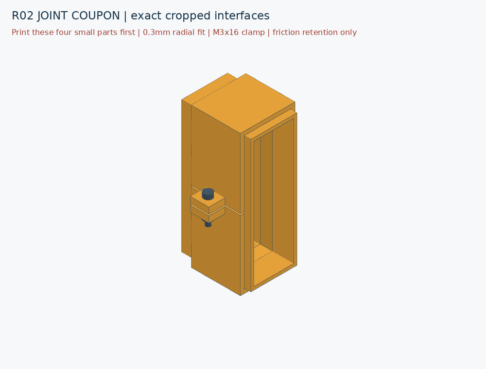

# R02 — P1S duct segments and three dedicated fans

[Project](../README.md) · [Design plan](x10drg-q-plan.md) · [P1S printing](p1s-printing.md) · [PSU options](x10drg-q-psu-options.md)

R02 turns the R01 cooling layout into **segmented fit prototypes for the confirmed Bambu P1S**. It assigns one 120mm fan to each passive RTX 8000, retains a separate inlet reservation for the blower card, and adds removable duct joints. The X10DRG-Q has not been ordered; PSU and fan models remain unselected.

This revision does not generate the full chassis, measured motherboard mounts, final GPU duct interfaces or fan mounting plates. The original chassis and R01 study are preserved.

## Geometry and layout result

| Layout | Default PSU reservation | Modeled result | P1S result |
|---|---|---|---|
| Compact, 584.2mm deep | Two 160mm bodies, each with 30mm cable space | Three clashes: lower PSU cable zone/slot-6 duct, upper PSU body/slot-8 duct, and upper cable zone/slot-8 duct | All 12 duct/collar pieces fit the configured placement envelope |
| Extended, 634.2mm deep | Same | No unintended intersections or boundary violations among the modeled envelopes | All 12 pieces fit, including a 5mm brim reservation and the cutter exclusion |

The **634.2mm layout remains the working candidate**. The depth is not yet fixed for manufacture. Actual GPU plugs, motherboard holes, absolute slot/I/O coordinates and final support hardware remain unmeasured or absent. A clear model is therefore a routing result, not a complete hardware-fit result.

Each of the three ducts comprises a GPU-side half, a fan-side half and two external collar halves: **12 printed pieces**, plus six M3 bolts and six nuts. The largest individual extents are **123 × 208 × 176.6mm** across the set; those maxima belong to different pieces. Saved STL bounds and suggested bed placement are recorded for every part.

R02 checks full fan volumes, including rotor space. The renders show hollow frames only to make the ducts visible. The outer fan/card envelopes and CPU cooler locations remain provisional. Lid intrusions, final fan mounts and duct supports are not established by this model.

### PSU size sensitivity

In the extended layout, 140mm and 150mm bodies pass the modeled checks with either a 30mm or 50mm cable zone. A 160mm body passes with 30mm, but fails with 50mm. The tested 180mm and 200mm bodies fail with either cable zone. All tested PSU profiles clash in the compact layout.

This supports keeping compact PSUs on the shortlist, but the cable-zone numbers are geometric reservations, not verified bend allowances. Select the actual cable kit before fixing PSU mounts. See the [Canadian candidates and connector budget](x10drg-q-psu-options.md).

## Cooling geometry

The dedicated fan bank forms an L: slot 8 uses the upper-left fan, slot 6 the lower-left, and slot 4 the lower-right. Slot 8 rises before the ducts widen, so the passages remain separate. The blower card in slot 2 retains its own side-air reservation.

All three fan faces have the same nominal 120 × 120mm allocation. The 2mm duct walls leave a **116 × 116mm opening** at each fan, before accounting for the fan frame and hub. The middle passages are **26 × 82mm internally**. The locating spigot narrows each passage locally to **22.2 × 78.2mm**, approximately **18.6% less area** than the regular middle section. These are sections perpendicular to chassis Y, not a measured minimum normal to the airflow. The upper route rises 100mm over a 101mm run (about 44.7°); its inclined passage and bends need pressure-loss evaluation.

Equal fan area does not establish equal airflow. The routes have different bends, the spigot is a restriction, and actual heatsink pressure drops are unknown. Fan selection, leakage control and cooling at the intended GPU power limits require measurement. The existing six front fans are retained as envelopes, not confirmed as the final intake arrangement.

## Joint assembly and fit test

The GPU-side section ends in a 10mm-long locating spigot. Its outer section is **25.4 × 81.4mm**; the fan-side receiver is **26 × 82mm**, giving **0.3mm nominal clearance on each side**. The spigot wall is 1.6mm. The clearance is configurable and must be calibrated to the actual printer/material.

The two collar halves sit around the 30 × 86mm outer duct section, spanning 32mm along the duct. Their nominal inner clearance is 0.3mm per side and their split gap is 1mm. Tightening the bolts closes the split to develop friction. **The joint has no positive axial lock and is not a chassis support.** Support the duct independently and record the axial pull/slip result before adopting the joint.

For each collar, the nominal fastener stack is:

| Item | Quantity | Stack or fit requirement |
|---|---:|---|
| M3 × 16 socket-head bolt | 2 | Head bears on upper 4mm ear; passes through 1mm initial split and lower 4mm ear |
| M3 nut | 2 | Approximately 3mm planning thickness below lower ear; actual nut/head dimensions require checking |
| Printed bearing stack | — | 9mm before tightening; with a 3mm nut, a 16mm under-head bolt projects approximately 4mm below the nut |

No washers or threaded inserts are included in that stack. If washers are added, recalculate engagement and protrusion. Bolt shafts, heads and simplified nut envelopes participate in the layout collision checks; screwdriver and wrench approach volumes are not yet modeled. Do not tighten until the ears distort or the airway wall buckles.

Print the **short joint sample first**, using the same intended material and orientation as the full parts. Inspect the slice, remove any support and elephant-foot interference, then dry-fit the spigot, receiver and collar. Record insertion/removal, leakage at the seam, bolt access, ear closure and axial slip. Change the clearance parameter from those measurements before printing long ducts. The sample can be tested without the motherboard or PSUs.

The full ducts are exported in an on-bed orientation, but have not been sliced. The rising passage, internal transitions and clamp ears need support/overhang review. The [P1S guide](p1s-printing.md) describes the placement allowance and the distinction between a fit prototype and a final operating material.

## Published artifacts

- [Extended assembly STEP](../cad/x10drg-q-r02/extended/layout.step) and [individual STEP pieces](../cad/x10drg-q-r02/extended/parts)
- [Short joint sample STEP](../cad/x10drg-q-r02/joint-coupon/layout.step) and [four sample pieces](../cad/x10drg-q-r02/joint-coupon/parts)
- [Layout comparison](../checks/x10drg-q-r02/comparison.json), [extended checks](../checks/x10drg-q-r02/extended/checks.json) and [joint checks](../checks/x10drg-q-r02/joint-coupon/checks.json)



## Build and next implementation work

```bash
python -m pip install -r requirements-cad.txt
python tools/build_x10drg_q_r02.py --output build/x10drg-q-r02
python -m unittest discover -s tests -v
```

Use a new output directory; the builder preserves existing outputs. Both layout variants generate assembly STEP, per-part STEP, oriented STL, actual CAD renders, dimensions and checks. The separate `joint-coupon/` directory contains the four short fit pieces and their assembled view. Its spigot and socket are cropped directly from the full slot-6 geometry, so the sample reproduces the actual joint. STL files remain generated locally, following the repository policy.

The next design inputs are the joint-fit result, actual GPU mouth/plug/bridge measurements, and the selected PSU cable kit. After obtaining the motherboard, measure its 14-hole pattern, slot planes and rear I/O before designing the tray and rear retention. The enclosure sections, reinforcement and load paths follow those interfaces; no full-chassis print release is implied by R02.
